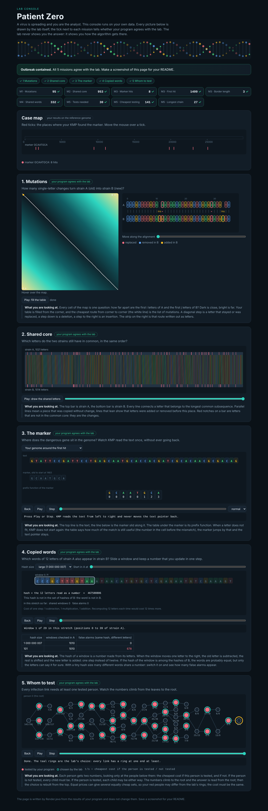

# Assignment 4. Patient Zero

Student ID: 253186
Name: Amangeldin Sherkhan
Group: SE-2536

This file is the report. How to start: `START_HERE.md`. The task: `docs/Assignment4.pdf`.

## Program output

The 9 lines my program prints on my data (`java -cp out Main`):

    Mutations: 95
    Shared core: 953
    Marker hits: 8
    First hit: 1499
    Border length: 3
    Shared words: 332
    Tests needed: 30
    Cheapest testing: 141
    Longest chain: 27

My outbreak report (a screenshot of `output/outbreak.html`, all 9 lines have a tick):

## Questions

**Mission 1.** d[i][j] is the smallest number of changes (replace, insert, delete) that turn the first i letters of A into the first j letters of B. It comes from three smaller cells: the diagonal d[i-1][j-1] (plus 1 if the letters differ, plus 0 if they are equal), the top cell d[i-1][j] + 1 (delete a letter of A) and the left cell d[i][j-1] + 1 (insert a letter of B). I take the minimum. The first row is 0..m and the first column is 0..n, because turning a word into an empty word (or back) costs its length.

**Mission 2.** In the LCS the letters must keep their order but may have gaps between them, and in a substring they must be next to each other with no gaps. My Shared core (953) is much bigger than the number of positions with the same letter at the same place, because after an insertion or deletion the rest of the strain shifts by one, and the LCS can still match those shifted letters. The table is the same, but the rule is different: equal letters give diagonal + 1, otherwise the max of top and left.

**Mission 3.** The prefix function pi[i] says how long the longest beginning of the marker is that is also the ending of marker[0..i]. KMP keeps k, the number of marker letters matched now. On a mismatch it does not go back in the text: it only shortens k to pi[k-1], because the last k letters of the text are already known to be the beginning of the marker, so we do not need to read them again. So the text pointer only goes forward and the search is O(n). My marker is GCAATGCA and its Border length is 3: the beginning "GCA" is also the ending of the marker. This is why two hits can overlap by 3 letters, and after a full match KMP goes to pi[m-1] = 3 instead of 0.

**Mission 4.** Different words can have the same hash (a collision), so equal hashes do not prove equal words. Without the comparison I would count words that are not in B. When hash is equal I compare the 12 letters. If many windows have the same hash (bad hash or small MOD), every check costs O(k) and the time goes from O(n + m) on average toward O(n * m * k) in the worst case. The lab console shows this with the tiny hash size: many false alarms.

**Mission 5.** Every person has two states: in[v] is the cheapest cost of his subtree if v is tested, out[v] is the cheapest cost if v is not tested. in[v] = cost[v] + sum over children of min(in[c], out[c]). out[v] = sum over children of in[c], because if v is not tested then every child must be tested to cover the link. The answer is min(in[0], out[0]), and to find who is tested I go down from the root with the same rule. A greedy "test the person with most links first" is not always best because a person with many links can be expensive, and several cheap neighbours can cover the same links for a lower total cost. Greedy also does not look at costs at all.

## AI use

I used Claude (Anthropic) as a helper for this assignment: it helped write and check the Java code for the missions, run the example checks and the benchmark, and draft the README. I read through the code and checked all 9 lines with `java tools/Check.java` and the lab console. No code or text from books or websites was copied.

## Timing (Mission 7)

Milliseconds, average of 3 runs, from `java -cp out Bench`.

| test | size | time |
|---|---|---|
| naive search | 20 000 | 45.1 ms |
| naive search | 40 000 | 119.0 ms |
| naive search | 80 000 | 230.5 ms |
| KMP | 20 000 | 4.2 ms |
| KMP | 40 000 | 1.9 ms |
| KMP | 80 000 | 0.4 ms |
| edit distance | 500 | 11.0 ms |
| edit distance | 1000 | 12.5 ms |
| edit distance | 2000 | 32.6 ms |
| edit distance | 4000 | 164.2 ms |

The naive search grows about 2 times when the text doubles on this input, so it is linear in the text, but it is also multiplied by the pattern length (2000) in the worst case. KMP stays tiny (a few ms, the changes are mostly JIT warm-up and noise), because it reads each letter of the text once. The edit distance grows about 4 times when the length doubles (32.6 to 164.2 ms from 2000 to 4000), which fits O(n * m) = O(n^2); the small sizes are dominated by JVM start-up.

## Complexity

n is the length of the text (or of a strain), m the length of the pattern, k the length of the window, v the number of people.

| algorithm | time | space | assumptions |
|---|---|---|---|
| Edit distance | O(n * m) | O(n * m) | full table of (n+1) x (m+1) cells, 3 operations per cell in O(1); could be O(m) if only the distance is needed |
| LCS | O(n * m) | O(n * m) | same table, one comparison and a max per cell |
| Prefix function and KMP | O(m) + O(n) = O(n + m) | O(m) | pi array of the marker; k goes back only as often as it went forward (amortized) |
| Rabin-Karp (shared words) | O(n + m + k) average, O(n * k) worst | O(m) | hashes of the windows of B in a HashMap; worst case when many hashes collide and letters are compared |
| Tree DP | O(v) | O(v) | every person and every link is visited once with BFS order, two numbers per person |
